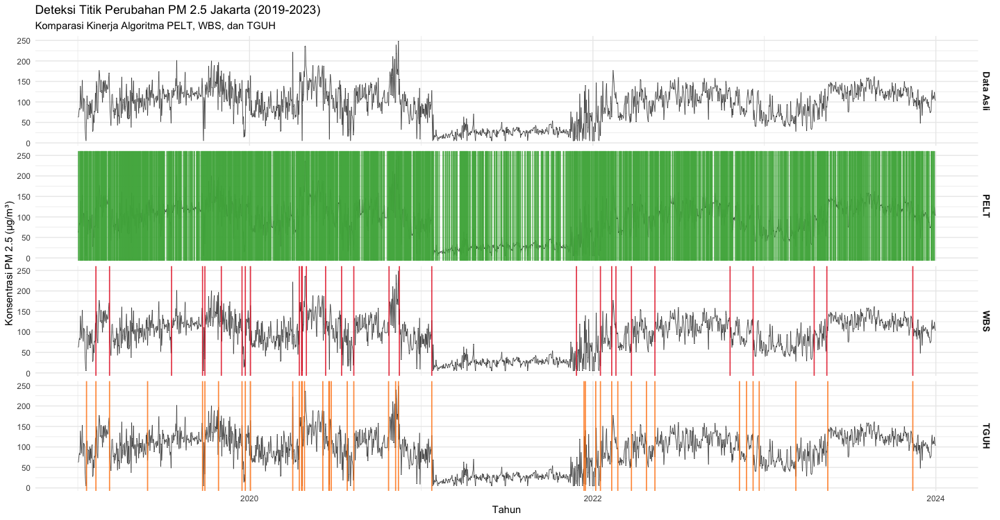
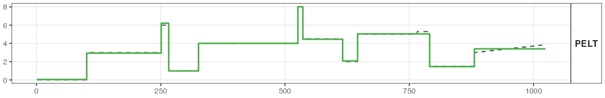

# Change-Point Detection for Time Series Data
A statistical framework for detecting sudden structural shifts and anomalies, applied to real-world environmental data and robust Monte Carlo simulations.

## 📌 Business Value
While this project utilizes PM2.5 air quality data as a real-world case study, the underlying mathematical framework is highly scalable and directly applicable to corporate data science and financial use cases, such as:
* **Anomaly Detection:** Identifying sudden spikes or drops in daily retail sales and revenue.
* **Risk & Fraud Analytics:** Detecting anomalous financial transactions or abrupt market shifts.
* **Operational Monitoring:** Tracking significant structural changes in server traffic or supply chain metrics.

## 📊 Project Overview
This project evaluates the robustness of 7 change-point detection algorithms using both real-world non-stationary datasets and rigorous statistical simulations.
1. **Real-World Application:** Applied the algorithms to daily PM2.5 pollutant concentration data in DKI Jakarta (2019-2023) to detect significant environmental shifts triggered by pandemic-era policies and weather changes.
2. **Synthetic Simulation:** Conducted 1,000 Monte Carlo iterations across various scenarios (e.g., Big Jump, Weak Signal, Complex Mix) to test algorithmic limits under different noise levels and variance extremes.

## ⚙️ Methodology & Tech Stack
* **Language:** R (via RStudio)
* **Libraries:** `breakfast`, `changepoint`, `wbs`, `imputeTS`, `dplyr`, `ggplot2`
* **Core Algorithms Evaluated:** 
  * Tail-Greedy Unbalanced Haar (TGUH)
  * Wild Binary Segmentation (WBS) with sSIC penalty
  * Pruned Exact Linear Time (PELT)

## 🚀 Key Findings & Visualizations

### 1. Handling Extreme Variance in Real-World Data (TGUH & WBS)
**Finding:** TGUH and WBS proved to be the most robust and optimal models for handling non-stationary datasets with extreme variance. As seen in the PM2.5 data, both algorithms successfully detected critical structural shifts that aligned with external policy/weather interventions.

*(Visualizing the detection comparison across original data, PELT, WBS, and TGUH)*

### 2. Maximum Precision for Homoscedastic Data (PELT)
**Finding:** Through the synthetic data simulations, PELT demonstrated the highest precision strictly for homoscedastic data (data with constant variance). The algorithm perfectly maps the underlying true signal shifts.

*(Visualizing PELT's precise detection on synthetic scenarios)*

## 📁 Repository Contents
* `riil - 19:23.R`: R script for data cleaning, stochastic imputation, and change-point detection on PM2.5 data.
* `sintetis - simulasi_TA.R`: R script containing the 1,000-iteration Monte Carlo simulation framework.
* `jakarta-air-quality.csv`: The raw dataset used for the real-world application.
* `Tabel Hasil Monte Carlo.pdf`: Complete evaluation metrics (Mean Sensitivity, Mean F1, Eta Error, Mean MSE) for all algorithms across simulation scenarios.
